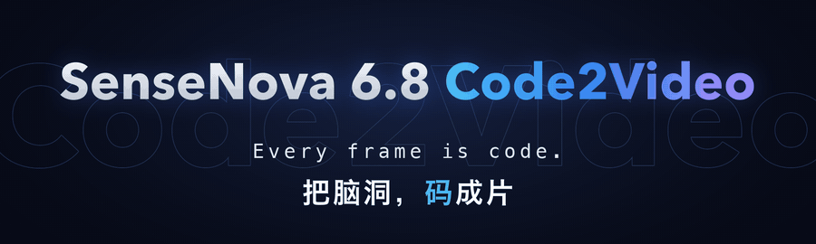
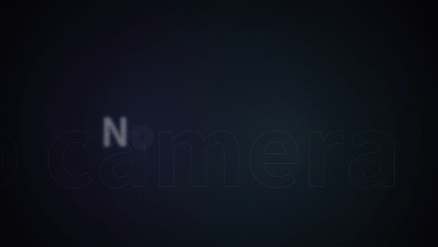
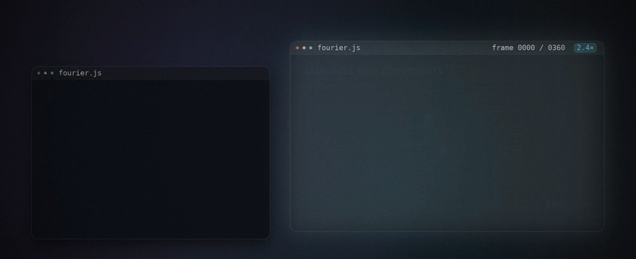
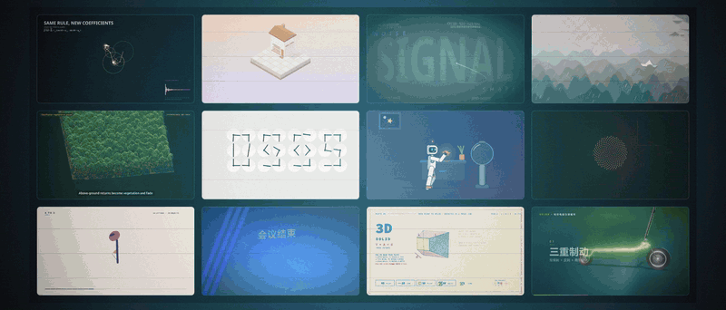
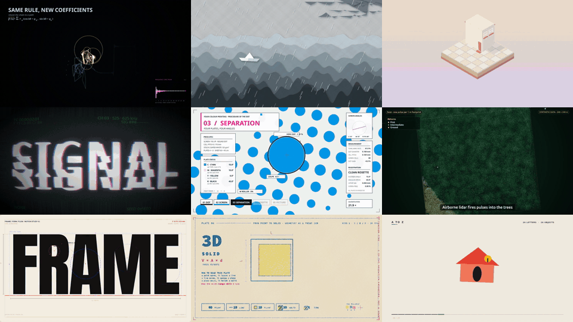

<div align="center">



# 把脑洞，码成片


[][hf]   

**简体中文** · [English](README.md)

</div>

## 📦 全部开放

| 开放内容 | 说明 | 获取 |
|---|---|---|
| 🤗 **模型权重** | SenseNova 6.8 Code2Video 模型权重 | [Hugging Face][hf] |
| 🎞️ **制作轨迹与 prompt** | 全部短片的完整制作轨迹和对应 prompt | [Hugging Face](https://huggingface.co/sysssyssy/sensenova-codevideo/tree/main/trajectories) |
| 📘 **部署文档** | 部署参数与部署方式 | [Hugging Face][hf] |
| 🧩 **Skill** | 固定的 code-video 制作 skill：制作流程、领域指南与渲染工具 | [`skills/code-video`](skills/code-video/SKILL.md) |
| ✍️ **Prompt 模板** | 把一句话创意扩写成完整的制作需求 | [`prompts/`](prompts/README.zh-CN.md) |

<div align="center">

<a href="media/launch/sensenova_codevideo_launch_film.mp4"></a>

**[▶ 观看 90 秒发布宣传片](media/launch/sensenova_codevideo_launch_film.mp4)** &nbsp;·&nbsp; **[🤗 Hugging Face][hf]**

<sub>宣传片由 SenseNova 6.8 Code2Video 制作，片中出现的所有视频也都由 SenseNova 6.8 Code2Video 制作。</sub>

</div>

<br>

> **今天，我们正式推出目前业内首个开源代码驱动的视频创作模型：SenseNova 6.8 Code2Video。**
>
> 我们相信，代码可以成为连接创意与作品的通用语言。SenseNova 6.8 Code2Video 是我们迈向通用创作智能的第一步：从仅由代码渲染的短片视频生成出发，逐步覆盖剪辑、合成、动画与更广泛的数字内容创作。
>
> 我们把模型权重、Skill 全部开放。本文中所有视频均由 SenseNova 6.8 Code2Video 使用一个 prompt 搭配 skill 一次做出，并且开源全部短片的制作轨迹和 prompt。

## ✨ 为什么是 SenseNova 6.8 Code2Video

### 🧑‍💻 不用摄像机，只写代码

不用摄像机，也不用素材库。文字、公式、图形、运动和声音全部写成代码，同一时刻永远渲染出同一帧；成片之后，想改哪里就改哪里。

<a href="media/launch/sensenova_codevideo_launch_film.mp4"></a>

### 🎨 一个模型，任意风格

数学科普、剪纸、等距插画、字体动效、数据可视化、角色动画、产品宣传片……换一句需求，就换一种视觉语言。

<a href="media/launch/sensenova_codevideo_launch_film.mp4"></a>

### 🔁 成片之后，还能越改越好

第一版不是终点。SenseNova 6.8 Code2Video 交付成片后，会继续听你的修改意见：换风格、加元素、调节奏，每一轮都在同一个工程里改代码、重新渲染，作品越改越完整、越丰富。

我们让它做一块复古的机场翻牌屏，再用两轮修改意见，把它打磨成一支更有设计感的短片：

<table>
<tr>
<td align="center" valign="top" width="33%"><a href="media/revision/departures_v1.mp4"></a><br><b>第一版</b><br><sub>聚光灯下的暗色翻牌屏</sub></td>
<td align="center" valign="top" width="33%"><a href="media/revision/departures_v2.mp4"></a><br><b>第二轮修改</b><br><sub>换成明亮的粉彩酒店大堂</sub></td>
<td align="center" valign="top" width="33%"><a href="media/revision/departures_v3.mp4"></a><br><b>第三轮修改</b><br><sub>加入飞过的飞机和拖着行李的旅客</sub></td>
</tr>
</table>

每一轮只需要一段文字意见；没有要求改动的文字、时序和翻牌动作都原样保留。

## 🎬 作品墙



<div align="center">

▶ [傅立叶光绘](media/showcase/fourier_light_painting.mp4) · [纸之海](media/showcase/paper_sea.mp4) · [纸与墨](media/showcase/paper_and_ink_bookshop.mp4)<br>
[信号与噪声](media/showcase/signal_noise_shape.mp4) · [四色印刷网点](media/showcase/v1_fx09_cmyk_halftone.mp4) · [森林下的滑坡](media/showcase/dpo_forest_landslide.mp4)<br>
[FRAME / FORM / FLOW](media/showcase/v1_frame_form_flow.mp4) · [几何孔版印刷](media/showcase/v1_geometry_risograph.mp4) · [A to Z](media/showcase/a_to_z.mp4)

<sub>九支短片均由 SenseNova 6.8 Code2Video 制作，点击片名观看带声音的完整影片。</sub>

</div>

## 🚀 快速开始

<table>
<tr>
<td align="center" valign="top" width="33%"><h3>1️⃣ 写好需求</h3>用 Claude Opus 5.5 或其他强模型，配合 prompt 模板把一句话创意扩写成完整的制作需求</td>
<td align="center" valign="top" width="33%"><h3>2️⃣ 交给 Claude Code</h3>把 SenseNova 6.8 Code2Video 接入 Claude Code，加载固定的 code-video skill，一次做出成片</td>
<td align="center" valign="top" width="33%"><h3>3️⃣ 看片，再改</h3>看完成片直接提修改意见，模型在同一个工程里改代码、重新渲染</td>
</tr>
</table>

<details>
<summary><b>展开完整步骤与命令</b></summary>

<br>

**准备任务目录**：需要 Claude Code、Node.js 18+、Python 3、ffmpeg/ffprobe 和覆盖视频语言的字体。skill 是固定的，原样复制即可。

```bash
git clone https://github.com/syssysyssy/sensenova-codevideo.git
TASK=/absolute/path/to/a-new-video-task
mkdir -p "$TASK/.claude/skills" "$TASK/assets"
cp -a sensenova-codevideo/skills/code-video "$TASK/.claude/skills/code-video"
python3 -m pip install -r "$TASK/.claude/skills/code-video/requirements.txt"
cd "$TASK" && npm install playwright && npx playwright install chromium
```

**增强 prompt**：按 [prompts 说明](prompts/README.zh-CN.md) 用模板生成 `request.md`，交给 Claude Opus 5.5 或其他强模型，把结果保存为任务根目录的 `prompt_dense.md`。例如：

```bash
claude -p --model claude-opus-5-5 "$(cat request.md)" > response.json
```

**接入 Claude Code**：在私有 settings 文件里填写部署好的模型（Anthropic Messages 兼容接口，`max model length = 512k`，部署说明见 [Hugging Face][hf]），认证通过 `ANTHROPIC_AUTH_TOKEN` 或 `ANTHROPIC_API_KEY` 注入。

```json
{
  "env": {
    "ANTHROPIC_BASE_URL": "https://your-model-endpoint.example.com",
    "ANTHROPIC_MODEL": "your-deployed-sensenova-code2video-model"
  },
  "model": "your-deployed-sensenova-code2video-model"
}
```

```bash
cd "$TASK"
claude --settings /absolute/path/to/private-settings.json --model your-deployed-sensenova-code2video-model \
  '使用项目中的 code-video skill。先读取 .claude/skills/code-video/SKILL.md 和 prompt_dense.md，再按需读取 crafts。当前目录是任务工程根目录。制作完整视频，执行渲染工具并完成至少两轮画面检查。交付 out/final.mp4、SPEC.md、VERIFY.md、联系表、源代码和复现命令。持续完成制作，直到实际视频通过验收；遇到阻塞请明确报告。'
```

**看片与修改**：在同一个会话里直接说想改什么（时间点、现在的问题、想要的效果），或者用 `--continue` 回到上次的会话；模型会在同一工程里修改并重新渲染。

</details>

<br>


[hf]: https://huggingface.co/sysssyssy/sensenova-codevideo
