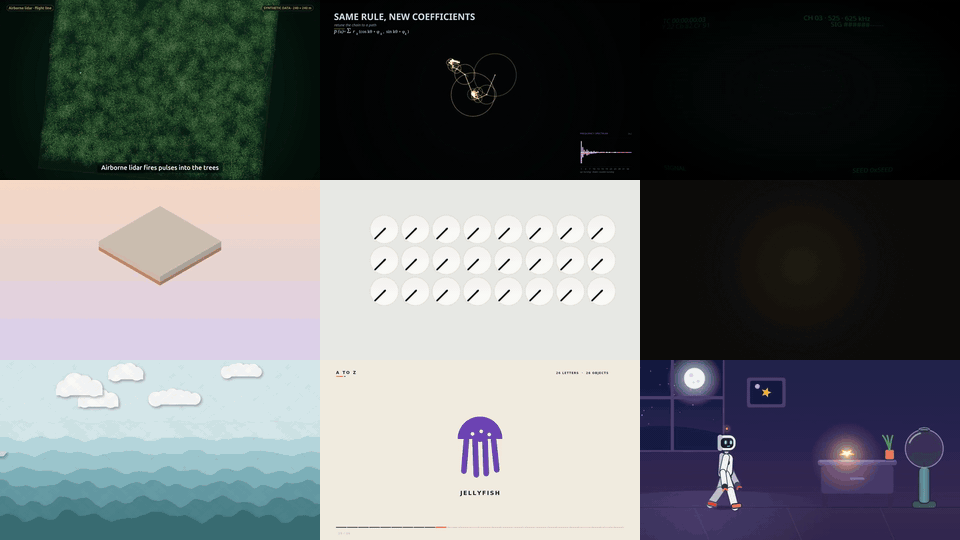
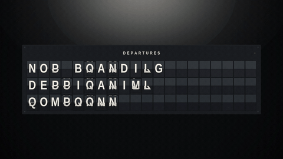
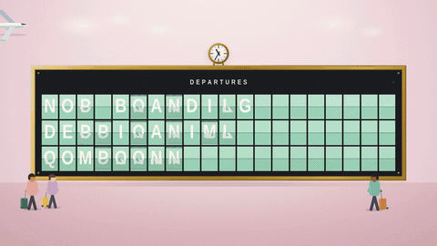

<div align="center">


# SenseNova 6.8 Code2Video

**小模型探索代码驱动视频创作的第一步**

[][hf]   [][discord]

**简体中文** · [English](README.md)

<a href="media/launch/sensenova_codevideo_launch_film.mp4"></a>

**[▶ 观看 90 秒发布宣传片](media/launch/sensenova_codevideo_launch_film.mp4)** &nbsp;·&nbsp; **[🤗 Hugging Face][hf]**

<sub>宣传片由 SenseNova 6.8 Code2Video 制作，片中出现的所有视频也都由 SenseNova 6.8 Code2Video 制作，完整影片见 <a href="media/showcase/"><code>media/showcase/</code></a>。</sub>

</div>

## 概述

我们提出 SenseNova 6.8 Code2Video，一个面向代码驱动视频创作的轻量级开源模型。该模型通过生成可执行代码构建与渲染视频，当前聚焦于完全由代码实现的短视频创作。初步结果显示，模型在动效设计中展现出良好的视觉构图与动态编排能力，体现了轻量级模型用于程序化视频创作的潜力。

我们选择从代码切入视频创作，也看重它连接不同模型与创作工具的潜力。在直接构建和渲染视觉内容的基础上，代码还可以连接图像生成、视频生成、三维建模与视频剪辑等模型和工具，将生成、编辑与合成串联为完整的创作流程。

我们相信，代码可以成为连接创意与作品的通用语言。我们的长期目标是让模型通过代码协同调用不同的生成模型与创作工具，实现跨媒介的数字内容创作。SenseNova 6.8 Code2Video 是这一方向上的初步尝试。未来，我们将进一步扩大模型规模，探索这些能力在剪辑、合成、动画及三维内容创作中的拓展。

我们开放以下内容，为研究者提供参考：

| 内容 | 说明 | 位置 |
|---|---|---|
| 🤗 **模型权重** | SenseNova 6.8 Code2Video，基于 Qwen3.8-27B 微调，512K 上下文 | [Hugging Face][hf] · [模型权重](#模型权重) |
| 📘 **部署** | 推理服务命令与推荐的 harness 配置 | [部署](#部署) |
| 🧩 **Skill** | `code-video`：制作流程、8 份领域指南与渲染、检查工具 | [`skills/code-video`](skills/code-video/SKILL.md) · [Skill](#skill) |
| ✍️ **Prompt 增强** | 把简短需求扩写为完整制作需求的模板 | [`prompts/`](prompts/README.zh-CN.md) · [Prompt 增强](#prompt-增强) |
| 🎞️ **制作轨迹** | 完整制作轨迹（消息、工具调用、回看的渲染图） | [Hugging Face](https://huggingface.co/sensenova/SenseNova-6.8-Code2Video) |

## 为什么是代码模型

### 生成模型的不足

生成模型已经能生成逼真的光照、材质和运动，但整段视频是在一次黑盒采样中生成的：

- **缺乏物理依据**：模型从画面中学到世界“看起来”是什么样，而不是从方程中学到世界如何运作，运动看似合理，物理上却可能是错的。
- **难以修改**：大小、时间和轨迹都隐含在生成过程中。想改一个细节，只能重写 prompt、重新采样整段视频，其余部分也会跟着变。
- **内容不精确**：画面文字、公式、图表和数据必须准确无误，却很容易出错。

### 代码的优势与展望

- **方便修改**：每个元素都是代码里有名字的对象。调整大小、时间、路线或风格只需改几行，其余部分完全不变，见下文[成片之后，还能越改越好](#-成片之后还能越改越好)。
- **内容精确可控**：文字逐字排版，公式和数据取自来源，坐标、时长、节拍和镜头路径都是明确的数值，可以逐项对照需求检查。每一帧都是 `t` 的纯函数，同一份代码永远渲染出同一支影片。
- **精确的物理建模**：运动、碰撞和光线都由方程计算，而不是凭外观猜测，画面里的物理过程经得起推敲。在此基础上，还可以引入生成模型产出的纹理、角色和背景，由代码精确摆放和计时，让画面更丰富、更精致。
- **成本更低，更快做出精致的影片**：画面由程序在普通硬件上绘制，一处修改只需重新渲染受影响的部分，渲染成本远低于视频模型采样。目前一次制作仍需数小时的 agent 时间，我们希望通过训练让模型用更少的轮数做出精致的成片。
- **更多方向**：代码渲染可以作为视频模型的快速预演，先确定布局、运动和镜头，再由视频模型生成最终外观；代码视频中的每个量都是已知的，同一份程序还能产出精确标注的数据（深度、相机位姿、多视角渲染），用于世界模型和 3D/4D 重建。

## 🎬 作品展示



<div align="center">

<a href="media/showcase/forest_landslide.mp4">森林下的滑坡</a> · <a href="media/showcase/fourier_light_painting.mp4">傅立叶光绘</a> · <a href="media/showcase/signal_noise_shape.mp4">信号与噪声</a><br>
<a href="media/showcase/paper_and_ink_bookshop.mp4">纸与墨</a> · <a href="media/showcase/clock_clock.mp4">时钟之钟</a> · <a href="media/showcase/golden_spiral_sunflower.mp4">黄金螺旋与向日葵</a><br>
<a href="media/showcase/paper_sea.mp4">纸之海</a> · <a href="media/showcase/a_to_z.mp4">A to Z</a> · <a href="media/showcase/robot_night_lamp.mp4">机器人与小夜灯</a>

<sub>点击片名观看带声音的完整影片。</sub>

</div>

### 🔁 成片之后，还能越改越好

这是代码和生成模型差别最大的地方。用生成模型时，改一处就要重写 prompt、重新采样，原本满意的部分也可能跟着变；这里每一条意见都变成一次代码修改，改动精确，其余部分保持不变。

第一版不是终点。SenseNova 6.8 Code2Video 交付成片后，会继续听你的修改意见：换风格、加元素、调节奏，每一轮都在同一个工程里改代码、重新渲染，作品越改越完整、越丰富。

我们让它做一块复古的机场翻牌屏，再用两轮修改意见，把它打磨成一支更有设计感的短片：

<table>
<tr>
<td align="center" valign="top" width="33%"><a href="media/launch/departures_v1.mp4"></a><br><b>第一版</b><br><sub>聚光灯下的暗色翻牌屏</sub></td>
<td align="center" valign="top" width="33%"><a href="media/launch/departures_v2.mp4"></a><br><b>第二轮修改</b><br><sub>换成明亮的粉彩酒店大堂</sub></td>
<td align="center" valign="top" width="33%"><a href="media/launch/departures_v3.mp4"></a><br><b>第三轮修改</b><br><sub>加入飞过的飞机和拖着行李的旅客</sub></td>
</tr>
</table>

每一轮只需要一段文字意见；没有要求改动的文字、时序和翻牌动作都原样保留。

## 模型权重

SenseNova 6.8 Code2Video 基于 Qwen3.8-27B，支持 512K 上下文，有较好的上下文压缩（compact）能力，能支持上千轮的长程会话。权重可从 [Hugging Face][hf] 下载：

```bash
huggingface-cli download sensenova/SenseNova-6.8-Code2Video --local-dir /path/to/SenseNova-6.8-Code2Video
```

## 部署

### [LightLLM](https://github.com/ModelTC/LightLLM)

```bash
docker run --rm --gpus all --ipc=host -p 8000:8000 \
  -v /path/to/SenseNova-6.8-Code2Video:/model \
  ghcr.io/modeltc/lightllm:main \
  python -m lightllm.server.api_server \
    --model_dir /model \
    --tp 4 \
    --max_req_total_len 524288 \
    --host 0.0.0.0 --port 8000
```

### [vLLM](https://github.com/vllm-project/vllm)

```bash
docker run --rm --gpus all --ipc=host -p 8000:8000 \
  -e VLLM_ALLOW_LONG_MAX_MODEL_LEN=1 \
  -v /path/to/SenseNova-6.8-Code2Video:/model \
  vllm/vllm-openai:latest \
    --model /model \
    --tensor-parallel-size 4 \
    --max-model-len 524288 \
    --reasoning-parser qwen3 \
    --enable-auto-tool-choice \
    --tool-call-parser qwen3_coder \
    --host 0.0.0.0 --port 8000
```

### [SGLang](https://github.com/sgl-project/sglang)

```bash
docker run --rm --gpus all --ipc=host -p 8000:8000 \
  -e SGLANG_ALLOW_OVERWRITE_LONGER_CONTEXT_LEN=1 \
  -v /path/to/SenseNova-6.8-Code2Video:/model \
  lmsysorg/sglang:latest \
  python -m sglang.launch_server \
    --model-path /model \
    --tp-size 4 \
    --context-length 524288 \
    --reasoning-parser qwen3 \
    --tool-call-parser qwen3_coder \
    --host 0.0.0.0 --port 8000
```

### 推荐 harness：Claude Code

完成一支影片是长程任务：模型写代码、渲染、看画面、再修改，一轮接一轮。SenseNova 6.8 Code2Video 支持**超过 10 小时、超过 2,000 轮**的连续运行。请按这样的时长配置 Claude Code：

| 设置 | 取值 | 配置方式 |
|---|---|---|
| 上下文窗口 | 512K | `CLAUDE_CODE_MAX_CONTEXT_TOKENS=524288` |
| 自动压缩 | 0.8 | `CLAUDE_AUTOCOMPACT_PCT_OVERRIDE=80` |
| 最大输出 | 64K | `CLAUDE_CODE_MAX_OUTPUT_TOKENS=65536` |
| 单次轮数 | 2,000+ | `--max-turns 2000` 或更多 |
| 单次时长 | 10 h+ | `timeout 10h` 或更长 |

请显式设置上下文窗口，否则 Claude Code 会把未知模型当作 200K 模型。压缩阈值 0.8、输出 64K 时，每个请求都在服务端 512K 的上限之内。

把接口地址和这些变量写进私有 settings 文件，认证通过 `ANTHROPIC_AUTH_TOKEN` 或 `ANTHROPIC_API_KEY` 注入：

```json
{
  "env": {
    "ANTHROPIC_BASE_URL": "https://your-endpoint.example.com",
    "ANTHROPIC_MODEL": "your-deployed-model-name",
    "CLAUDE_CODE_MAX_CONTEXT_TOKENS": "524288",
    "CLAUDE_AUTOCOMPACT_PCT_OVERRIDE": "80",
    "CLAUDE_CODE_MAX_OUTPUT_TOKENS": "65536"
  },
  "model": "your-deployed-model-name"
}
```

避免缓慢的 shell 初始化：每次 Bash 调用都会启动一个新的 shell。

## Skill

[`code-video`](skills/code-video/SKILL.md) skill 把制作拆成明确、可检查的流程：写规格、把每一帧写成时间的函数并渲染、把联系表作为图像读回来检查、验收交付文件。skill 覆盖了 8 份领域指南：科普讲解、风格化画面、模拟与生成、角色动画、3D 场景、动态图形、声音与旁白、音乐卡点。skill 本身是固定的，所有任务使用同一版本。

**安装 skill**：`code-video` skill 就在本仓库的 [`skills/code-video`](skills/code-video/) 中，把它复制到任务目录的 `.claude/skills/code-video` 即可（项目级安装）。请把 `TASK` 设置为任务目录的绝对路径：

```bash
TASK=/absolute/path/to/a-new-video-task
git clone https://github.com/OpenSenseNova/SenseNova-6.8-Code2Video.git
mkdir -p "$TASK/.claude/skills"
cp -r SenseNova-6.8-Code2Video/skills/code-video "$TASK/.claude/skills/"
```

也可以把地址交给 agent，让它代为安装，例如：

> *请把 [https://github.com/OpenSenseNova/SenseNova-6.8-Code2Video/tree/main/skills/code-video](https://github.com/OpenSenseNova/SenseNova-6.8-Code2Video/tree/main/skills/code-video) 安装到当前任务目录的 `.claude/skills/code-video`。*

安装完成后，**可能需要手动重启 agent 服务**，新 skill 才会被加载。

**准备运行环境**：需要 Claude Code、Node.js 18+、Python 3、ffmpeg/ffprobe 和覆盖视频语言的字体。首次运行时，环境安装可能耗时较长，推荐先装好运行环境，再开始制作：

```bash
python3 -m pip install -r "$TASK/.claude/skills/code-video/requirements.txt"
cd "$TASK" && npm install playwright && npx playwright install chromium
```

**启动 Claude Code**：在任务目录中用私有 settings 文件启动 Claude Code，settings 中的接口地址和参数配置见[推荐 harness](#推荐-harnessclaude-code)：

```bash
cd "$TASK"
claude --settings /absolute/path/to/private-settings.json --model your-deployed-model-name
```

## Prompt 增强

按 [prompts 说明](prompts/README.zh-CN.md) 用 [Enhance prompt 模板](prompts/enhance_prompt.md)生成 `request.md`，交给 Claude Opus 5.5 或其他强模型，把结果保存为任务根目录的 `dense_prompt.md`。

**开始制作**：完成配置和 prompt 准备后，运行以下命令；请将 settings 文件路径和模型名称替换为实际值。

```bash
cd "$TASK"
claude --settings /absolute/path/to/private-settings.json --model your-deployed-sensenova-code2video-model \
  '使用项目中的 code-video skill。先读取 .claude/skills/code-video/SKILL.md 和 dense_prompt.md，再按需读取 crafts。当前目录是任务工程根目录。制作完整视频，执行渲染工具并完成至少两轮画面检查。交付 out/final.mp4、SPEC.md、VERIFY.md、联系表、源代码和复现命令。持续完成制作，直到实际视频通过验收；遇到阻塞请明确报告。'
```

**看片与修改**：在同一个会话里直接说想改什么（时间点、现在的问题、想要的效果），或者用 `--continue` 回到上次的会话；模型会在同一工程里修改并重新渲染。

## 局限

- **适用范围**：模型只能制作可以写成代码的视频，如动态图形、科普讲解、风格化 2D/3D 场景和程序化音频，不能生成写实拍摄画面。
- **成本**：一次制作需要数小时和很长的上下文，结果依赖 harness 配置（上下文长度、压缩阈值、输出上限，见[部署](#部署)）。
- **评测**：目前只给出定性示例，还没有面向代码视频的系统性评测基准，我们认为这是一个重要的开放问题。
- **与前沿模型的差距**：在画面完成度和长程稳定性上，模型与最强的闭源模型仍有明显差距。用小型开源模型缩小这一差距，正是这次开源的目的。
- **prompt 增强**：模型自身也能做 prompt 增强，但效果比较基础；用 Claude 等更强的模型来增强 prompt，能进一步提升成片的美学表现。

## 贡献者

<table>
<tr>
<td align="center" width="110"><a href="https://github.com/moolean"><br><sub><b>Tiankuo Yao</b></sub></a></td>
<td align="center" width="110"><a href="https://github.com/syssysyssy"><br><sub><b>syssysyssy</b></sub></a></td>
<td align="center" width="110"><a href="https://github.com/Mr-Tony921"><br><sub><b>Mr.Tony</b></sub></a></td>
<td align="center" width="110"><a href="https://github.com/penghao-wu"><br><sub><b>Penghao Wu</b></sub></a></td>
<td align="center" width="110"><a href="https://github.com/dder4a42"><br><sub><b>Dder</b></sub></a></td>
<td align="center" width="110"><a href="https://github.com/M1M1cooL"><br><sub><b>Ming</b></sub></a></td>
<td align="center" width="110"><a href="https://github.com/shiyigueris-cmyk"><br><sub><b>shiyigueris-cmyk</b></sub></a></td>
<td align="center" width="110"><a href="https://github.com/ottolu"><br><sub><b>Lewei Lu</b></sub></a></td>
</tr>
</table>

[hf]: https://huggingface.co/sensenova/SenseNova-6.8-Code2Video
[discord]: https://discord.com/channels/1488006693395628032/1488015977932390520
